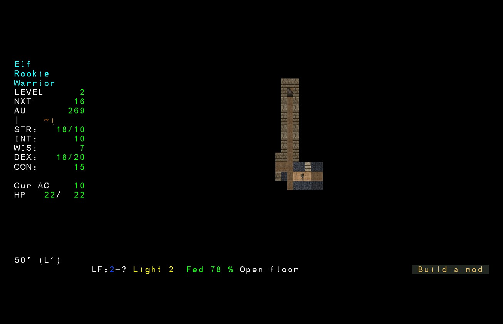
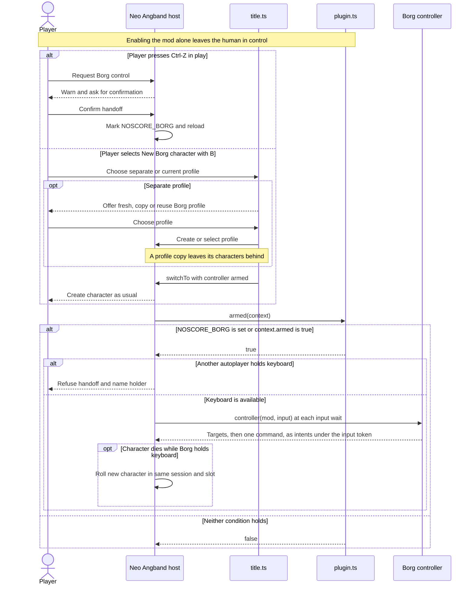
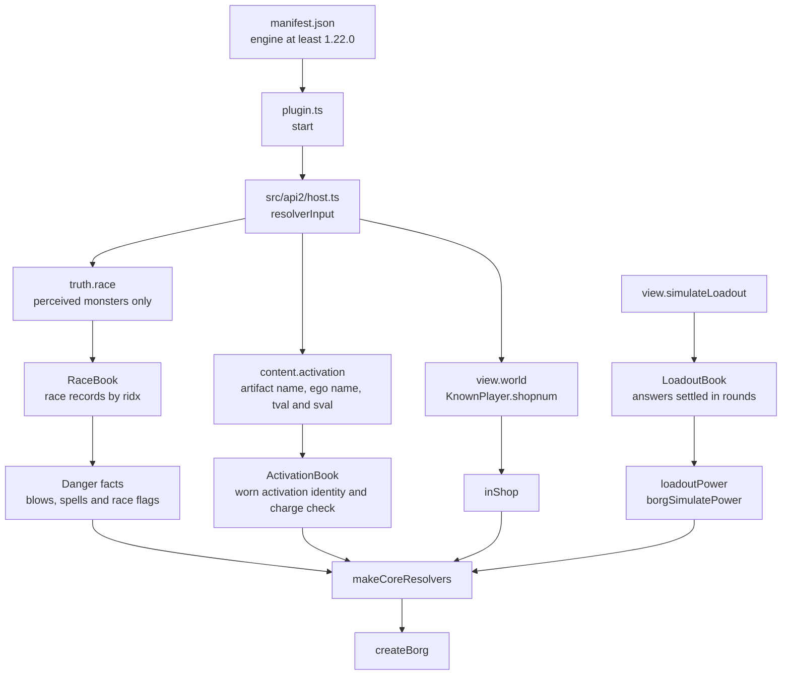
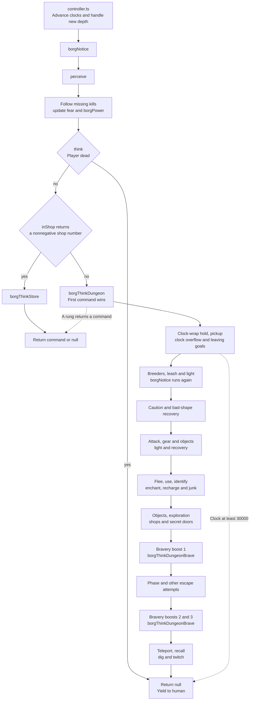
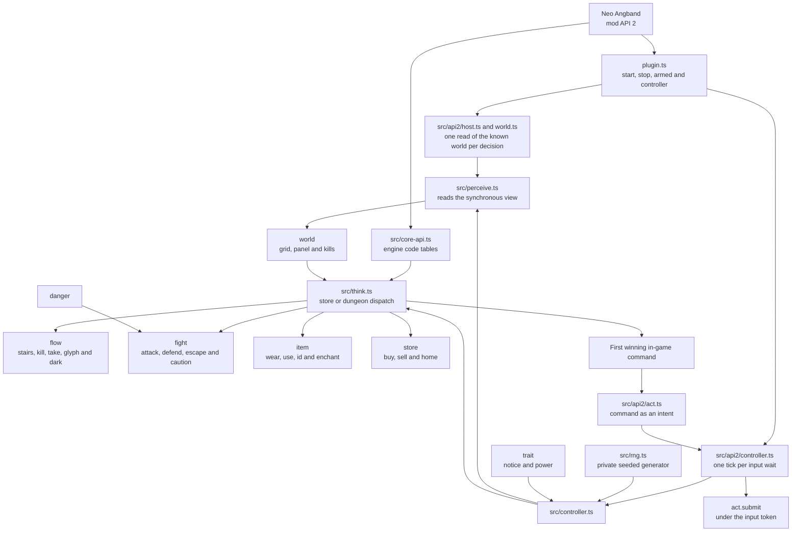

# neo-angband-mod-borg

Borg (Angband's automatic player) for
[Neo Angband](https://github.com/neostryder/neo-angband), as a mod.

**Needs Neo Angband 1.22.0 or newer.** An older game refuses to load it and says so; [How well it plays today](#how-well-it-plays-today) explains why it refuses instead of running a reduced Borg.

Install it from the game's **Install a mod...** row. Enabling the mod does **not**
hand it your character: press **Ctrl-Z** in play to warn, confirm, and hand over
the keyboard. Press Ctrl-Z again (or any other real key) to take it back.

The title screen also has a **New Borg character** row (key B) when you allow the Borg to add title screen rows and manage profiles. It asks where the character should live. The default is a separate profile, so the Borg's options, mods, mod settings and characters stay apart from your own games: start a fresh profile named Borg, copy an existing profile's options, mods and mod settings without its characters, or reuse a profile the Borg made before. You can also start it in the profile you are using. Either way you create the character as usual, and the Borg takes the keyboard when play begins. If the game refuses the separate profile, the row shows the reason and starts the character in your current profile instead.

## What it is

*Source of truth: `plugin.ts`, `title.ts`, and the README. The host owns the permanent autoplay mark.*

*Source of truth: `plugin.ts`, `src/api2/host.ts`, `src/api2/caches.ts`, and `src/resolvers.ts`. The bridge also supplies kind cost and attack-message data from content records it reads once at start.*

A faithful port of Angband 4.2.6's `borg/`: the same priority ladder, the same danger model and the same power scoring, following the original's rules instead of a new set of heuristics that only look similar.

### How well it plays today

*Source of truth: `src/controller.ts`, `src/think.ts`, and `src/think-ladder.ts`. Several rungs are still unported, including destroy-valueless, play-magic, and ring swaps.*

The port in `src/` and the mod you install are not quite the same thing. The installed mod depends on `plugin.ts`, which builds the Borg from resolvers the game supplies, and for a long time most of those did not exist.

All four resolvers are wired: danger vision, activation identity, the in-shop signal, and the power of a hypothetical loadout. Race records come from the truth domain, activations from the game's content records, the shop under the character from the known world, and loadout scores from the game's own simulation. So `borg_danger` works from real blows, spell frequencies and race flags. The Borg knows whether a worn item has the activation it wants and is charged, knows which shop it stands in, and can score gear it is not wearing; it wears what it finds, buys what it needs and sells what it is done with. A monster or item from another mod is treated like one of core's, because every lookup goes by index (`ridx`, `tval`/`sval`, ego or artifact name) and never asks where the record came from. Without the truth domain, danger falls back to the flags and spells the character has learned.

When it dies it starts a new character, and the game does that, not this mod. A controller can only return an in-game command, and there is no command for "roll me a new character", so the game's death handler does it whenever a mod holds the keyboard. It is an in-session reincarnation, not a new save: same session, same slot, a rolled race and class each time, as upstream's borg respawns.

The loadout scoring and the death handler both arrived in Neo Angband 0.25.0, and this version requires Neo Angband 1.22.0 or newer instead of running in a reduced form on an older game. Earlier versions declared `>=0.12.0` and fell back. On a game without the loadout support, the Borg wore nothing it found, bought nothing it needed and sold nothing it was done with, and on a game without the death handler, a death simply ended the run. That left a Borg unable to do the two things a Borg is for. No earlier version of this mod ran a working autoplayer on any game, so the stricter requirement takes nothing away from anyone.

Watched in the released 0.25.0 desktop build on 2026-08-21, over two characters, the Borg took the keyboard, shopped, wore what it bought, found the town's down staircase and descended, and then stalled on the first dungeon level both times without dying. Five separate causes turned up, four of them one-line fixes:

- a locked door arrived as a trap to disarm, and `disarm` refuses one for free;
- nothing in the port ever used a staircase it was standing on;
- a readiness flag was initialised to "never asked" and never asked;
- arriving on a level did not clear "use the next staircase", so the Borg shuttled between town and level one;
- a hypothetical loadout's score was compared against a live one derived a different way, which in a daytime town differed by 14000 points, made every wearable item look like an upgrade, and turned two identical torches into an endless swap.

The first of those was in the game, and so was a sixth problem: an autoplayer used to stop at every prompt that waits for a keypress, so going downstairs needed a human. The other four were in this repository. `src/play.test.ts` found those four and now guards all five. It boots a real game, hands it to the Borg and drives 1500 decisions per seed, checking that no single command takes over the session and that the character covers ground. Over four seeds the Borg now explores hundreds of squares, opens doors, disarms real traps, changes level on its own, and dies, which is where upstream's borg ends up too and is what the restart loop needs.

Watched again, it lost a fight it should have won: a level-one character stood still in town while something it could not see killed it. The decision code was working correctly on bad information, reading six values that nothing in this mod ever wrote. Upstream's answer to an attacker it cannot find is regional fear, and this port had the caches, the two functions that fill them and every reader that consults them, with nothing connecting them. Alongside that, the check for "is it safe to rest here" was the constant `true`; none of the durations the Borg tracks were ever counted down, so each one stuck after its first use; and the table that tells the Borg which object is a Ration of Food started out empty, so a full pack counted as no food, no cures, no phase doors and no fuel. All six are fixed.

The reported habit of "sitting there or moving frantically back and forth across three cells" had two causes. One was the staircase shuttle above, seen on the version before it was fixed. The other was a phantom: nothing in the port ever downgraded a monster record, so a monster that died out of sight or walked away stayed on the Borg's map for two thousand turns, and the Borg kept walking to where it used to be. Over four seeds of 2000 decisions each, the number of sixty-decision stretches spent inside three squares with nothing in sight and nothing to heal went from 403 to zero, and the ground covered nearly doubled.

On 2026-08-22 it was watched again, and this time it played: thirteen minutes in the development build and four in the packaged 0.26.0 artifact, each on its own isolated data directory. There were no mod faults and no console errors. It answered 37 blocking prompts without a human, picked four locked doors a turn at a time, found four secret doors by searching, killed thirteen monsters in the artifact run, and had four characters die and start again on their own. It fled twice under a low-hitpoint warning by taking the stairs, arrived in town at 6 of 11 hit points, and rested back to 10 before diving again.

Shopping works end to end. The Borg can identify the shop it is in, evaluate purchases and sales, and issue `shop-buy`, `shop-sell` and `shop-exit` through the engine's command registry. Placed by hand on a real shop door across ten seeds, it sold something with a real inventory change in all ten, and bought something, with gold actually decreasing, in three of the ten. What nobody has seen yet is the Borg walking itself to a shop during real play. In every seed tried, a fresh level-one character heads straight for the dungeon stairs before the "deal with shops" decision comes up, so its trips back to town are upstream's own cautious level-one behaviour, not the ladder choosing to shop.

Install it to watch it try, not to watch it win. Most of the other test files cover dispatch, ladder ordering and resolver wiring and never play a turn, so they say nothing about how well it plays; `play.test.ts` covers that, and `rest.test.ts` covers the path the in-town death went through.

It is a mod, not part of the engine, for two reasons:

- It is not core because an automatic player inside the parity target would put an automated control surface inside the thing being kept faithful to Angband 4.2.6. Upstream's borg is a compile-time option precisely because it is not the game.
- It uses the published mod API and nothing private. It reads the known world, sends the same commands your keys do, and has no test hook. Two of the parts it reads are restricted: only first-party mods get the truth domain, and the engine domain, where the port finds the game's numeric code tables, takes first-party status or your consent. If the Borg could only be written against internals, the modding API would not be finished, and that is worth finding out.

The second point is what makes it worth having. It is the most demanding mod anyone could write against this API, so it is the best available test of whether the API does what it claims. Two of the problems found while wiring it up were engine bugs, not Borg bugs.

## Telling it how to play

See the [settings reference](SETTINGS.md) for every flag, its default, and when a change takes effect.

Upstream's borg reads a `borg.txt` out of the user's Angband folder and takes
about thirty settings from it. There is no such folder here, and no path to one
on a phone, so those settings are toggles in the mod manager. Each one's
description names the `borg_` setting it is, so a `borg.txt` you already have
translates row by row. Handing over the keyboard itself is Ctrl-Z, not a toggle.

    Play risky                     borg_plays_risky
    Value melee and missile damage borg_worships_damage
    Value speed                    borg_worships_speed
    Value hit points               borg_worships_hp
    Value spell points             borg_worships_mana
    Value armour class             borg_worships_ac
    Value gold                     borg_worships_gold
    Save up for something it wants  borg_self_scum
    Skimp on stockpiles for an early munchkin run borg_munchkin_start

Every default is upstream's own, so leaving all of them alone gets the Borg
Angband ships. *Save up for something it wants* is the one that starts on,
because `borg_self_scum` does.

Play risky is the setting that changes the most. It skips the early hit-point
and character-level floors that hold the Borg above a depth, makes it wait longer
before drinking a cure, and makes it back away later in a losing fight. It gets
deeper faster and it dies more.

The five "Value" settings are how the Borg weighs a piece of gear, and they
stack: switching on two adds both weights. They are the closest thing here to
telling it what kind of character to be, because what a Borg wears is most of
what it becomes. There is no separate setting for stat priorities, and there is
none upstream either - `borg.txt` describes one in a comment, but no setting
backs it and the reincarnation code just takes the game's default point-buy.

Skimp on stockpiles for an early munchkin run moves how the Borg values
consumables at a low character level, on the assumption that a young character
is cashing out for gold rather than settling in. It does not make the Borg
stair-scum for loot the way `borg_munchkin_start` also does upstream - that
half needs a diving mode this port has not built.

A changed toggle takes effect on the next reload, the same as any other mod
setting. The log line the Borg writes when it takes the keyboard names every
setting that is not on its stock value, so the record of an unattended run says
what it was told to do.

Three of upstream's settings are deliberately absent rather than merely
unimplemented: `borg_kills_uniques` and `borg_uses_dynamic_calcs` each need a
subsystem this port does not have (a live census of which uniques are still
alive, and a whole second formula-driven calculation engine), and
`borg_uses_swaps` has a reader but nothing downstream of it - the swap items it
would value are not ported either, so the toggle would tick and the Borg would
play identically either way. The numeric settings - depth ceilings, the enchant
limit, a pinned race or class to respawn as - have no yes-or-no shape, and the
host's mod-manager toggle is boolean only, so there is no rule type to carry one
yet. See PLANNED.md for what each of these still needs.

Since Neo Angband 0.27.2 the mod manager also shows an **Autoplayer speed**
row while an autoplayer holds the keyboard, with Turbo/Fast/Normal/Slow tiers
(10/40/120/400 milliseconds a turn) as of 0.28.0. That control is the host's,
not this mod's: any mod that declares a controller gets the row for free, with
no manifest change here.

## Two things it does not do

- It does not read the real map. Upstream's borg reads the game's own structures directly (its comments call these "cheats") and scrapes the terminal for the rest. This one plans from the known world: the remembered map, the pack, and the stores as the character last saw them. With the real-map permission turned on, it also reads the exact hit points and race records of the monsters the character can perceive, and nothing else. It acts only through commands a player could issue.
- It does not cost you reproducibility. Borg is deterministic: it draws
  only its own seeded generator and never the game's, so a Borg game stays
  replayable and the save's determinism ratchet stays untripped. An autoplayer that
  used a wall clock or a network would trip it, and would have to declare that in
  its manifest.

  It does mark the character. Handing the keyboard over sets the save's `NOSCORE_BORG` flag, which keeps the character off the high-score table and adds an `[Autoplayed]` block to its dump. That is upstream's own behaviour, and it is one-way: a character that has run the Borg for one turn carries the mark for the rest of its life.

Only one autoplayer can hold the keyboard at a time. If another agent mod already
has it, this one is refused by name rather than silently taking over.

## Layout

*Source of truth: `plugin.ts`, `src/api2/controller.ts`, `src/controller.ts`, and `src/think.ts`. The Borg draws from its own seeded generator, not the game's random stream.*

    manifest.json    what the game reads: id, engine range, capabilities, toggles
    plugin.js        the built artefact the game fetches and hashes; committed
    plugin.ts        the entry point: the API 2 definition (start, stop, armed, controller)
    src/api2/        the bridge between mod API 2 and the port
    src/             the port itself

`src/api2/host.ts` and `src/api2/controller.ts` are the place to start under `src/`: they read the game, build the view the port decides from, and submit its commands. `src/core-api.ts` holds the engine's code tables, and its header explains the single rule that arrangement imposes on every other file. [docs/API2-MIGRATION.md](docs/API2-MIGRATION.md) describes the whole arrangement.

## Building and testing

    pnpm install --frozen-lockfile
    pnpm verify     # typecheck, test, and prove plugin.js is a current build

`plugin.js` is committed, because an install fetches it from a pinned tag and runs it
as it is; nothing rebuilds it on the way in. So a stale artefact passes every other
check and is the file players actually run. `pnpm check` is what stops that.

The suite runs the port **and** drives the built `plugin.js`, which is a different
artefact: the engine arrives through ESM live bindings, and whether those survive
bundling is a separate question from whether they work in TypeScript.

To develop against an unreleased engine:

    NEO_ANGBAND_LOCAL_CORE=1 pnpm test

## Releasing

A tag matching `vX.Y.Z` is the release: there is no separate publish step. A
minor or major bump posts an announcement to the RPGM Tools Discord's Neo
Angband announcements forum automatically, built from the matching
[CHANGELOG.md](CHANGELOG.md) heading. A patch-only bump stays quiet by design.

## Questions, or something wrong

[**The RPGM Tools Discord**](https://discord.gg/YegtwbHTBQ) is the fastest way
to ask anything - whether a behaviour is intended, how to get this installed,
or what you should try next. No GitHub account needed.

[Open an issue here](https://github.com/neostryder/neo-angband-mod-borg/issues/new/choose) for a bug in **this mod**. Two
things belong against the game instead, and the forms will point you there: the
mod **system** (an install that fails, a load order that will not stick, a
conflict report that looks wrong), and the game **not matching Angband 4.2.6**
once this mod is switched off - changing the game is what a mod is for.

For anything that should not be public, including a security report:
**strider-angband (at) rpgm.tools**. See [SECURITY.md](SECURITY.md), which also
links to the core policy for anything owned by the engine rather than this mod.

Asking about AI use in this project? [AI_USAGE_POLICY.md](AI_USAGE_POLICY.md) is
the complete answer.

[TERMS.md](TERMS.md) covers use of this mod. The core repository's
[PRIVACY.md](https://github.com/neostryder/neo-angband/blob/master/PRIVACY.md)
covers what is stored and what network requests the game makes. Project
participation is subject to the shared [CODE_OF_CONDUCT.md](CODE_OF_CONDUCT.md).

## Licence

Same dual licence as Neo Angband and Angband: GPL v2 or the Angband licence. See
[LICENSE.md](LICENSE.md).

## Credits

Angband is the work of Ben Harrison, James E. Wilson, Robert A. Koeneke and the
Angband contributors. The borg is Ben Harrison's, extensively developed by Dr
Andrew White and maintained since by the Angband contributors; this is a port of
**their** work to TypeScript, not a new autoplayer that resembles it. Where it
differs from 4.2.6 it says so in the source, beside the C function it came from.
The port is by neostryder / RPGM Tools.
