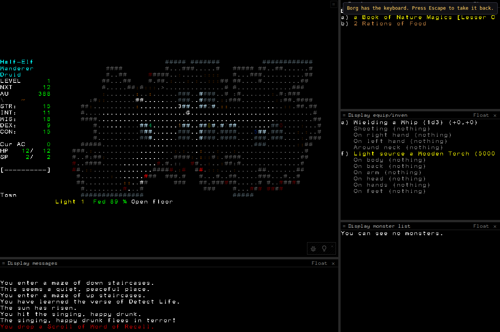

# Reporting and real-game launch validation

This is a synthetic validation recording, not another cohort or a survival result.

- The real Neo frontend at official engine `d27ed50f9e3b650a43cceda5a0c007d03cc321df`
  launched both Human Druid seed1746645326 and Half-Elf Druid seed305119160 from
  recorded turn-zero births. The exact recorded Borg plugin started automatically.
- The crow-case browser check measured actual start turn0, Half-Elf/Druid,
  HP12/SP2/gold388, birth stats17/10/16/10/16 and grid25,4, matching the retained
  birth. The normal Borg banner appeared; after seven seconds the game was at
  tick210, with inventory, equipment, messages and monster panels visible. No
  browser runtime errors were reported. This checks real UI startup and play;
  it does not assert equality of the full graphical and headless trajectories.
- A retained legacy-bundle control repeats the crow death at2442. A reconstructed
  wild-cat clip matches all original command events (SHA256
  `c9916e4a6aea7e80bccaa821d6d28ebffed54a616b22c9e08e6fb97bf51d4233`).
  Display observations do not become independent lives in the report.
- Lightweight process/report/host controls:35passing, no skips. Pinned-engine
  point-buy/native-menu RNG controls:8passing. The actual API2/production-session
  truth-host gate passes, including full floating-eye attacks, no actual-map
  grant, durable receipt, failed-write denial and cleanup.
- The reused gameplay source still passes its ordinary1194-test suite; final PR
  CI independently verifies the published branch. No gameplay or engine source
  is changed by this follow-up.

The screenshot is from Neo's normal renderer. The separate report's known-state
animation is labelled as reconstructed observations, not an original screenshot.

## Delay and live resume follow-up

Real-frontend browser regression: `autodelay=250ms`, `startDelay=3000ms` leaves
actual turn0 visible with no controller running during the initial delay. The
Borg starts, Escape pauses at turn40, and the game remains at40 through a
600ms observation. Ctrl-Z resumes ordinary Borg play to turn50, with no runtime
errors and no reload/reseed. The final lightweight suite has36passing controls,
including rejection of invalid delay values before any game/output is created.

## Before-death and zero-delay check

For the original crow endpoint2442, `--before-death 100` requests2342 and selects
the last recorded command boundary2333 (actual lead109). A read-only save observer
runs only at the selected command ordinal; the full replay command hash remains
`5339bc6b9168a2594b3c66de7ec62d2be7dfd6fb188aa056111f3a1aeec7c89d`.
The real frontend loads2333 with the saved engine RNG verified unchanged at Borg
startup. With `--autodelay 0` it advances to2593 in the one-second browser check,
with no runtime errors. That progression is a fresh-Borg saved-position diagnostic,
not a rescue claim or exact continuation of original private controller memory.
The expanded lightweight regression suite passes38cases without skips.

## One life and 1000-ms default

The diagnostic wrapper uses the standard API2 `onDeath: end` policy and releases
Borg ownership when the ordinary death handler runs. A real-game wild-cat saved
position test with the default1000-ms controller interval ends at860, remains
at860 after a1.5-second observation, reports the life ended, and has no active
Borg owner or browser runtime errors. No character was automatically rerolled.
A prepare-only check confirms the default autodelay1000 and single-life setting;
all generated near-death commands explicitly specify `--autodelay 1000`.
